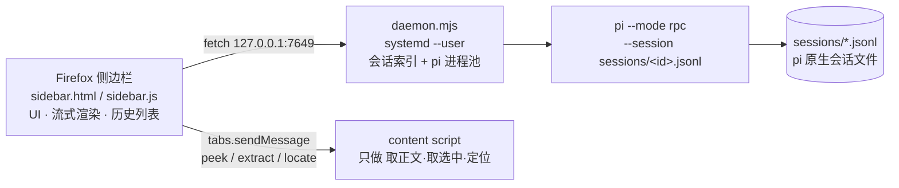

# pi 网页问答 · Firefox 侧边栏

Firefox 侧边栏里的 AI 对话面板（形态参考 Cursor 的 chat）：把**当前网页正文 + 划选文字**作为上下文，可连续追问；对话永久留在磁盘、随时找回，还能在终端用 `pi --session` 接着聊。

后端是**你本机的 [pi](https://github.com/earendil-works/pi) coding agent**（RPC 模式），除了本机 → 你自己配置的模型 API 那一次调用，**不经过任何第三方服务**。

- 一个对话 = 一个 pi 原生 session 文件，上下文由 pi 自己恢复
- 回答里的引用块可以点「↗ 定位原文」，跳回页面并高亮那句话
- 首轮对话后用一个小模型自动生成 8~16 字会话标题
- daemon 只监听 `127.0.0.1`，不出网
- 会话可以用 `pi --session <file>` 在终端续聊

## 架构



## 前置条件

- Node.js 18+
- [pi](https://github.com/earendil-works/pi) 已安装并可用（`pi --mode rpc` 能跑），且已在 `~/.pi/agent` 里配好 provider / model
- Firefox 115+
- systemd（`--user`）。没有 systemd 也行，手动 `node daemon.mjs` 即可

## 安装

```bash
git clone https://github.com/qmindong/pi-web-ask.git
cd pi-web-ask
./install.sh            # 写 ~/.config/systemd/user/pi-web-ask.service + enable --now
curl -s http://127.0.0.1:7649/health
```

不装服务、临时跑：

```bash
node daemon.mjs
```

然后在 Firefox 里加载侧边栏扩展：

1. `about:debugging#/runtime/this-firefox` → **临时载入附加组件…**
2. 选 `extension/manifest.json`
3. `about:addons` → ⚙ → **管理扩展快捷键** → 「打开 pi 侧边栏提问」设为你喜欢的键（默认 `Alt+Shift+P`）
4. 入口：`视图 → 侧边栏 → pi 问答`，或点工具栏按钮

> `Win/Super + L` 是系统锁屏快捷键，浏览器扩展抢不到，别设这个。
> Firefox 正式版不允许未签名扩展永久安装 → 重启 Firefox 后需重新临时载入一次。
> 想彻底解决：用 Firefox ESR / Developer Edition，把 `xpinstall.signatures.required` 设为 `false`。

## 用法

| 操作 | 说明 |
| --- | --- |
| `Alt+Shift+P` | 打开侧边栏、聚焦输入框，自动读取当前标签页 |
| 选中文字后提问 | 选中内容单独作为「✂️ N 字」附在问题旁 |
| 上下文行 `✂️ 选中 N 字` 旁的 **✕** | 本次不带这段选中文字（显示 `⊘ 忽略中 ↺` 可撤销；在页面上重新划选会自动解除） |
| `Enter` / `Shift+Enter` | 发送 / 换行 |
| `＋` / `☰` / `←` | 新对话 / 历史对话 / 返回对话 |
| `>_` | 复制 `pi --session '<file>'`，粘到终端继续这个对话 |
| 回答里的 `> 引用块` → ↗ | 高亮并滚回页面原句 |
| `✂️` / `📄` chip | 点回当时选中的文字 / 切到那一页的标签页 |
| 生成中点 ■ | 停止生成 |
| 快捷 chips | 解释这段 / 翻译这段 / 总结全页 / 三个要点 |

**上下文注入规则**：新对话的第一问、同一对话里换了页面时，自动附带整页正文；追问时如果又新划选了片段，只补这段；其余追问只发问题（上下文已在 pi 的 session 里）。这是省 token 的关键。

**把侧边栏移到右边**：Firefox 没有相关扩展 API，是浏览器设置 —— 侧边栏顶部工具切换按钮 → 「Move Sidebar to Right」；或 `about:config` → `sidebar.position_start` → `false`。

## 数据与配置

默认数据目录 `~/.local/share/pi-web-ask/`（**从 git clone 出来的仓库自己不会带这些文件**，daemon 启动时自动创建）：

| 位置 | 内容 |
| --- | --- |
| `sessions/*.jsonl` | 对话记录（pi 原生格式，可直接 `pi --session` 续聊） |
| `index.json` | 会话索引（标题 / URL / 轮次），丢失会自动从文件重建 |

想放到别处：`PI_WEB_ASK_DATA=/path/to/data`。

环境变量（写在 systemd unit 的 `Environment=` 里，或直接 export）：

| 变量 | 默认 | 说明 |
| --- | --- | --- |
| `PI_WEB_ASK_PORT` | 7649 | 端口（改完要同步改 `extension/sidebar.js` 的 `DAEMON`） |
| `PI_WEB_ASK_MAX_PAGE` | 60000 | 送进 prompt 的正文字符上限 |
| `PI_WEB_ASK_MODEL` / `_PROVIDER` | 跟随 pi 默认 | 换模型 |
| `PI_WEB_ASK_THINKING` | 跟随 pi 默认 | off/low/medium/high/max |
| `PI_WEB_ASK_TITLE_MODEL` | 跟随 pi 默认 | 只用于生成会话标题的模型（可填更便宜的，如 `deepseek-chat`） |
| `PI_WEB_ASK_TITLE_PROVIDER` | `settings.defaultProvider` | 标题生成用哪个 provider 的 api_key |
| `PI_WEB_ASK_IDLE_MS` | 1800000 | 空闲多久回收 pi 进程（会话不丢） |
| `PI_WEB_ASK_MAX_LIVE` | 4 | 同时存活的 pi 进程数 |
| `PI_WEB_ASK_DATA` | `~/.local/share/pi-web-ask` | 数据目录 |
| `PI_WEB_ASK_PI` | 自动探测 | pi 可执行文件路径 |

## HTTP 接口（便于脚本化）

```bash
GET    /health
GET    /sessions                # 历史列表
POST   /sessions                # {url,title} → 新建
GET    /sessions/<id>           # 索引 + 消息（已剥离大段正文）
PATCH  /sessions/<id>           # {title} 重命名
DELETE /sessions/<id>
POST   /sessions/<id>/retitle   # 用首轮提问重新生成标题
POST   /ask                     # {sessionId?, question, selection, page:{url,title,text}} → NDJSON 流
POST   /abort                   # {sessionId}
```

`/ask` 的 NDJSON 事件：

```
{"type":"session","id","title","url","turns","withContext","withSelection","path"}   // 首帧
{"type":"delta","text":"…"}                                                         // 增量
{"type":"done","text":"完整答案"}                                                   // 以 message_end 为准
{"type":"end"}
{"type":"error","message":"…"}
```

## 排查

| 现象 | 处理 |
| --- | --- |
| 侧边栏报「连不上本地 daemon」 | `systemctl --user restart pi-web-ask`，再 `curl 127.0.0.1:7649/health` |
| 历史是空的但文件还在 | 重启 daemon（会重建 `index.json`） |
| 正文抓得不全 | 站点用 iframe / 虚拟滚动 / canvas，先把要问的区域选中再问 |
| 回答慢 | `PI_WEB_ASK_THINKING=off` 或换更快的模型 |
| 侧边栏读不到页面 | 装扩展之前就开着的标签页需要刷新一次 |
| 定位原文点不动 | 引用被模型改写、内容在 iframe 内、或懒加载没滚到 |

## 已知限制

- **未签名扩展不能永久安装**：Firefox 正式版每次重启要 `about:debugging` 重新临时载入
- 整页正文靠 DOM 提取，iframe / 虚拟滚动 / canvas 渲染的站点抓不全
- 定位原文依赖模型逐字引用，被改写就找不到
- 成本：每轮输入 ≈ 正文 token（默认上限 60k）+ 历史；长页面反复新开会话会明显花钱 → 同一页面内用追问

## 文档

- [docs/DESIGN.md](docs/DESIGN.md) —— 上下文注入、会话标题生成、定位算法、进程池的设计与踩过的坑

## License

[MIT](LICENSE)
